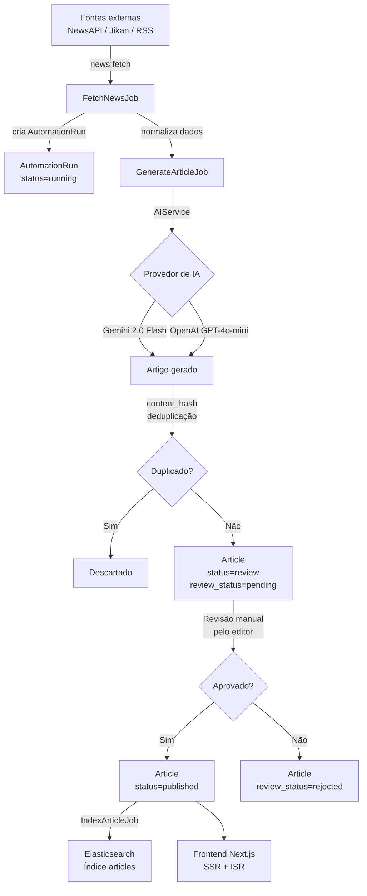

# Arquitetura — NovaTech Blog

## Visão Geral

O NovaTech é uma plataforma de notícias automatizada com três camadas principais:
backend Laravel (API + jobs), frontend Next.js (blog público) e infraestrutura Docker.

---

## Fluxo de Automação



---

## Diagrama ASCII (alternativo)

```
┌─────────────────────────────────────────────────────────┐
│                    COLETA (Agendado)                    │
│  NewsAPI  ──┐                                           │
│  Jikan API ─┼──► FetchNewsJob ──► GenerateArticleJob   │
│  RSS Feed  ─┘         │                   │            │
│                        ▼                   ▼            │
│               AutomationRun          AIService          │
│               (log + custo)      (Gemini / OpenAI)      │
└──────────────────────────┬──────────────────────────────┘
                           │
                           ▼
              ┌────────────────────────┐
              │  PostgreSQL (Artigos)  │
              │  status = 'review'     │
              │  review_status='pend.' │
              └────────────┬───────────┘
                           │  Revisão manual
                           ▼
              ┌────────────────────────┐
              │  status = 'published'  │
              └────────────┬───────────┘
                    ┌──────┴──────┐
                    ▼             ▼
            Elasticsearch    Next.js 14
            (busca/filtros)  (blog público)
```

---

## Componentes

| Componente | Tecnologia | Responsabilidade |
|---|---|---|
| API REST | Laravel 11 | Endpoints públicos e admin |
| Jobs assíncronos | Laravel Queue + Redis | Coleta e geração de artigos |
| Provedor de IA principal | Google Gemini 2.0 Flash | Geração de conteúdo (baixo custo) |
| Provedor de IA alternativo | OpenAI GPT-4o-mini | Fallback configurável |
| Banco de dados | PostgreSQL 16 | Fonte oficial dos dados |
| Cache e filas | Redis 7 | Processamento assíncrono |
| Busca | Elasticsearch 8 | Pesquisa textual avançada |
| Blog público | Next.js 14 App Router | SSR + ISR para SEO |

---

## Política de Publicação (MVP)

1. Artigo gerado → `status=review`, `review_status=pending`
2. Editor acessa painel admin → aprova ou rejeita
3. Aprovado → `status=published`, indexado no Elasticsearch
4. Publicação automática pode ser ativada por fonte, conforme confiança

---

## Segurança Editorial

- Conteúdo gerado por IA é baseado em fontes verificáveis
- Fontes originais são sempre armazenadas em `article_sources`
- Deduplicação por `content_hash` (md5 do título + conteúdo)
- Limite diário de artigos gerados por IA (`AI_MAX_ARTICLES_PER_DAY`)
- Limite de custo estimado (`AI_ESTIMATED_COST_LIMIT_USD`)
